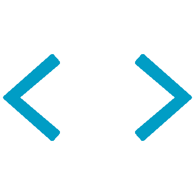

<!-- Header -->


<div align="center">

<a href="https://git.io/typing-svg">
  
</a>

<br/>

<p align="center">
<a href="https://www.linkedin.com/in/lucca-sena"></a>&nbsp;<a href="mailto:luccasena22@gmail.com"></a>&nbsp;<a href="https://www.instagram.com/luccasenab/"></a>&nbsp;<a href="https://discord.com/users/754177812923154553"></a>&nbsp;<a href="https://gitlab.com/luccasena"></a>&nbsp;<a href="docs/Lucca%20de%20Sena%20Barbosa%20.pdf"></a>
</p>

<p align="center">

</p>

</div>

---

##  About me



```python
class LuccaSena:
    location   = "Brazil 🇧🇷"
    role       = "Computer Science Student"
    focus      = "AI Engineering"
    learning   = ["Machine Learning", "Deep Learning", "AI Agents", "Web Development"]
    goal       = "Become an AI Specialist delivering data-driven solutions"

    def say_hi(self):
        return "Always looking for real-world challenges to learn and grow 🚀"
```

- 🎓 **Computer Science student** focused on **AI Engineering**
- 🤖 Currently exploring **LLMs, AI Agents and Deep Learning**
- 📊 Passionate about turning **data into insights and real solutions**
- 🤝 Open to **internships, collaborations and AI projects**

<br clear="right"/>

---

##  Tech stack

<table>
  <tr>
    <td><b>Languages</b></td>
    <td></td>
  </tr>
  <tr>
    <td><b>AI / Machine Learning</b></td>
    <td></td>
  </tr>
  <tr>
    <td><b>AI Agents & LLMs</b></td>
    <td><a href="https://github.com/modelcontextprotocol/typescript-sdk"></a></td>
  </tr>
  <tr>
    <td><b>Back-end</b></td>
    <td></td>
  </tr>
  <tr>
    <td><b>Front-end</b></td>
    <td></td>
  </tr>
  <tr>
    <td><b>Databases</b></td>
    <td>
      <br/>
      
    </td>
  </tr>
  <tr>
    <td><b>Cloud & DevOps</b></td>
    <td>
      <br/>
      
    </td>
  </tr>
  <tr>
    <td><b>Data & BI</b></td>
    <td></td>
  </tr>
  <tr>
    <td><b>Tools</b></td>
    <td></td>
  </tr>
</table>

---

## 📈 GitHub metrics

<div align="center">


</div>

<!-- Footer -->

